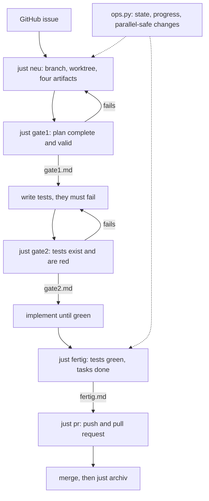

# ops-lab

A small lab for testing and tuning a spec-driven workflow for AI coding agents:
OpenSpec changes, machine-checked **Gates**, and an **ops** view of what is running.
It builds the tooling around the workflow, not a product. The workflow is meant to be
measurable.

The tooling, specs and notes in this repo are written in German (identifiers, messages,
documents). Terms such as *Gate* and *Change* are used as they appear in the code.

## Problem

An AI coding agent given a vague request produces output that looks finished but is hard to
trust. Nothing states what was asked for, nothing shows that the tests were red before the
fix, and "done" is the agent's own claim. Several agents working in parallel add merge
conflicts on top.

## Approach: Spec → Gates → ops

1. **Spec.** Every piece of work is an OpenSpec *change*: `proposal.md` (why, what, scope,
   files it touches), a delta spec with scenarios, and `tasks.md` naming the test files.
2. **Gates.** A gate is a command with an exit code, not a confirmation. It cannot be
   skipped, and a failing gate writes no proof file. There is no override variable; bypassing
   a gate means changing its code, which shows in the diff.
3. **ops.** `ops.py` shows the state of all changes and worktrees: progress, which gates are
   passed, which changes can start without touching each other's files, and which are
   blocked or orphaned.

Each gate rule is a pure function in `tools/pruefungen.mjs` with its own test. A gate that
cannot be tested is only an assertion.



Gate 1 checks the plan: no template placeholders left, required proposal sections, a delta
spec with scenarios, one to eight tasks, test files named, `openspec validate --strict`, and
that `justfile` was only appended to. Gate 2 checks that the promised test files exist, that
at least one is new or changed against `main`, and that the test run fails. The closing step
checks that both gate proofs exist, no task is open and the tests are green. `just pr`
refuses to push without `fertig.md`. Details: [CLAUDE.md](CLAUDE.md).

Every change gets its own git worktree and branch, so the main checkout stays on `main` and
several agents can work at once. Two changes may run in parallel only if their declared file
sets are disjoint.

## Try it

Requirements: Node 22 or newer, `just`, Python 3, [`openspec`](https://github.com/Fission-AI/OpenSpec).
`gh` is needed only for the pull request steps. There is no `package.json`, no build and no
dependencies.

```bash
just                # list all recipes
just lint           # syntax check of tools and tests
just test           # node --test plus the self-test of ops.py
just ops-once       # one-shot view of changes and worktrees in this repo
just web-trocken    # payload of the web view as JSON (no server, no extra packages)
```

`just ops-test` and `just sync` expect a sibling repository `../ops-lab-test` where the
workflow is applied; it is not part of this repo.

## What the lab measured

Only results backed by files in this repo are listed.

- **Same task, four measured runs.** The task text is fixed and fingerprinted
  (`pruefwert f9a4283f183d`, see `docs/messungen/auftrag-amortisation.md`). Between the runs
  the workflow tooling was changed, and the token count fell:

  | Session | Tokens (total, incl. cache reads) | Shell commands | Requirements met |
  |---|---|---|---|
  | `bd8914a3` | 5.02 M | 44 | 3 of 7 |
  | `89401f6c` | 2.59 M | 46 | 7 of 7 |
  | `40d36a23` | 1.81 M | 43 | 7 of 7 |
  | `a165f80e` | 0.90 M | 24 | 7 of 7 |

  Source: `docs/messungen/2026-09-20-amortisation-claude-*.json`. The counting method also changed in between (tokens per API response, commit `e9eb0d2`); the earlier runs were re-measured with it (`ba063bc`). Each row is a single run, the
  model is not recorded, and the cost of the last run is incomplete. Read it as a direction,
  not as a benchmark.
- **A green gate hid a removed check.** A refactoring replaced "does the change folder exist"
  with "does the worktree exist". All gates stayed green, because the old check had no test.
  It was caught by hand after the merge and fixed with three regression tests. Rule derived:
  every machine check needs a test. See `docs/beobachtungen.md`.
- **A gate can be green and still write no proof.** `just gate1` passed all checks and then
  failed with `EISDIR` while writing `gate1.md`. From the outside this looks the same as a
  failed gate. See `docs/beobachtungen.md`.
- **Gate 2 cannot judge test quality.** It requires a failing test run, so `assert.fail()`
  passes it like a proper scenario. Whether the red test checks the right thing stays with
  a human.
- **Scope promises were not enforced at first.** The file list in `proposal.md` was not
  compared to the diff. The `abgleich` capability later added a comparison that reports
  deviations in both directions but deliberately does not block
  (`openspec/specs/abgleich/spec.md`).
- Test state of this repo: 442 tests in `node --test`, all passing.

## Status

Experimental, one author, German-language tooling. The workflow ran end to end in the
sibling test repo; the 23 archived changes under `openspec/changes/archive` are the history
of this repo's own tooling, and three changes are still open. Known open points are in
`docs/beobachtungen.md`.

`openspec validate --all --strict` currently reports warnings (requirement text over 500
characters) that the installed OpenSpec 1.14 treats as failures in strict mode. Without
`--strict` all 9 specs and changes validate.

## Layout

| Path | Purpose |
|---|---|
| `tools/gate.mjs` | the three gates |
| `tools/pruefungen.mjs` | what a gate decides about a text; pure and tested |
| `tools/neu.mjs` | create a change: worktree, branch, folder, four artifacts |
| `tools/tokens.mjs`, `tools/messlauf.mjs` | token and cost measurement per run |
| `tools/sync.mjs`, `tools/install.mjs` | roll the tooling out to other repos |
| `ops.py` | live view of changes (standard library only; the optional web view uses FastAPI via `uv run --with`) |
| `openspec/specs/` | capability specs of the tooling itself |
| `docs/` | observations, measurements, diagrams |

## License

MIT, see [LICENSE](LICENSE).
